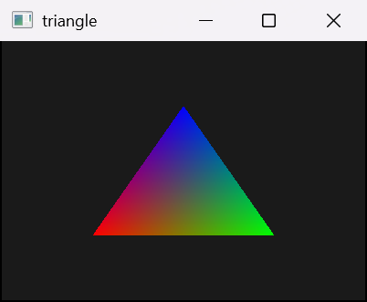
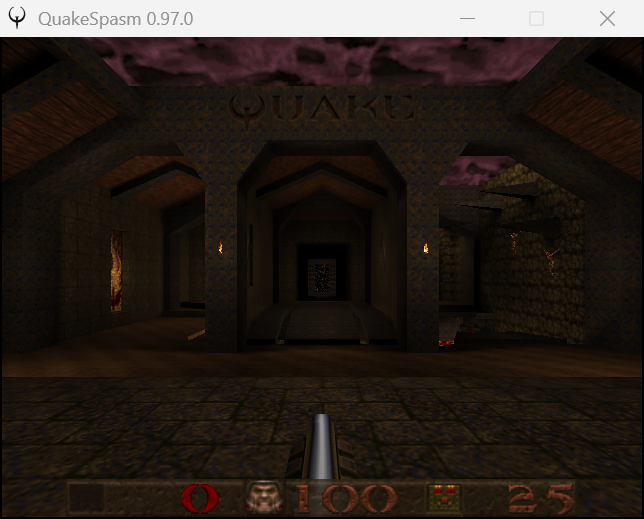

# softgpu

A software GPU for Windows: an OpenGL 1.1 driver in plain C that renders on the CPU.



## Build

Requires CMake 3.28+ and MSVC, clang or MinGW-w64 GCC. With MSVC, use the Developer Command Prompt of the target architecture.

```sh
cmake -B build -G Ninja
cmake --build build
```

For 32-bit apps, also build x86 in `build-x86`.

## Run

- `build\harness` tests the driver directly.
- `build\wgltest` tests it through `opengl32.dll` once installed.
- `build\triangle` draws a triangle with GLFW.

## Install

From an elevated PowerShell, with both builds:

```powershell
scripts\install.ps1
scripts\uninstall.ps1
```

softgpu then drives every OpenGL app until uninstalled or until a GPU driver update.

## Performance

This project aims for the speed of [llvmpipe](https://gitlab.freedesktop.org/mesa/mesa/-/tree/main/src/gallium/drivers/llvmpipe) and the simplicity of [softpipe](https://gitlab.freedesktop.org/mesa/mesa/-/tree/main/src/gallium/drivers/softpipe): readable C, no JIT. MSVC is the primary optimization target.

## Supported games

- Quake, through [QuakeSpasm](https://quakespasm.sourceforge.net/) 0.97.0, 32-bit and 64-bit.


